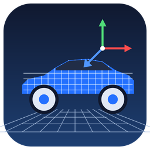

<p align="center"></p>

<h1 align="center">ForzaPartTool</h1>

<p align="center">A Windows desktop app for editing the cars of <b>Forza Horizon 1</b> (Xbox 360, on Xenia or a modded console).<br>
3D model viewer, part editing, custom models and DLC export, plus Python libraries for the game's file formats.</p>

<p align="center">  </p>

<p align="center"><a href="#features">Features</a> · <a href="#file-formats">File formats</a> · <a href="#getting-started">Getting started</a> · <a href="#building-from-source">Building</a> · <a href="#known-limitations">Limitations</a></p>

> You need your own copy of the game (a Games on Demand folder, an `.iso` or an extracted folder). Nothing from the game is in this repository. Modding is at your own risk: keep a backup of your game files and your save, and test one change at a time. Not affiliated with Microsoft, Turn 10 or Playground Games.

## Features

**Viewer**

| | |
|---|---|
| 3D car view | Every part with its LODs (0-5), per-part show/hide/isolate, filter box, selection box, normals and wireframe |
| Textures | Per-material textures from the car's own atlases ("all textures"), damaged versions, and single-atlas inspection |
| Wheels | The file holds one wheel at the centre; the viewer draws it at the four corners from the car's wheelbase and track (or hides it) |
| Interior | The driving model's low-detail interior can be replaced in the preview by the sharp interior of the cockpit model, with lit dials; a model switcher opens the driving, close-up/photo and cockpit files |

**Editing**

| | |
|---|---|
| Parts | Move / rotate / scale with a gizmo (snaps to 1 cm, 1 degree and 1 %, so 90 degrees is easy to hit; hold Alt to turn snapping off; one handle can scale all sides together) or numbers, mirror, rename, merge into another part, copy a part from another car, delete or retarget sub-meshes, hide a part from the game; every step undoable |
| Sub-parts | Click a name under a part (a material, all LODs together): rename it, give it a flat colour, take it out as a part of its own or move it into another part (or drag it onto a part in the list); it glows in the view |
| Glass and lamps | Window tint, lamp glass tint and strength, bulb colours and brightness (the car's `ShaderSettings.xml`), shown in the view and saved with the car |
| Both models | Edits can be applied to the driving model and the close-up/photo model together |
| Custom models | Import FBX, GLB/glTF or OBJ (and, as an experiment, a part from a modern Forza game: a `.modelbin`, sharpest LOD, no textures), place it with the gizmo, and add it as its own part (stays selectable and movable) or merge it into an existing part; automatic LODs; optional texture painted into the car's atlas |
| Lights and exhausts | Light records and exhaust emitters, with position and colour |
| Physics | Collision spheres, hull and body numbers (wheelbase, track, ride height, bounding box) |
| Other tabs | Skeleton and animations (`.gr2`), archive browser, string tables, texture viewer and replacement |

**Saving**

| | |
|---|---|
| Save project | Saves everything you have done in the tool (the open model with its edits, staged files and painted textures, body numbers) as one `.fptproj` file without writing anything into the game; open it again later or drag it onto the window. Exporting as a DLC car also saves one next to the package |
| Export car ZIP | A replacement car archive for an extracted game or DLC copy |
| Apply to existing car | Writes into a writable game or DLC folder (a `.bak` is made once) |
| Export as a new DLC car | A new car with its own ID and database rows, as a Xenia folder and/or console package, using your edited files; the output folder is remembered. It also writes the project, the model as OBJ + MTL (for Blender), and an experimental folder of `.modelbin` files, one per part |

Also: a loading bar while cars load, **Unload car**, and remembered game and DLC folders. Saved settings live in `%APPDATA%\FH1CarbinEditor` (the folder keeps its first name so nothing is lost on upgrade) and never leave your computer.

## File formats

| Extension | What | Read | Write |
|---|---|---|---|
| `.carbin` | Car models (sections, LOD vertex pools, sub-meshes, draw lists, lights, exhausts) | yes | yes |
| `.fptproj` | A ForzaPartTool project (a zip: the open model, staged files, car origin, body numbers) | yes | yes |
| `.modelbin` | Models of newer Forza games (experimental: geometry only, no textures, not tested in the game) | yes (sharpest LOD) | yes (one per part, on DLC export) |
| `.obj` + `.mtl` | Wavefront model, for Blender | yes (custom model) | yes (on DLC export) |
| `.xds` | Xbox 360 textures (DXT1/3/5, 8888) | yes | yes |
| `.zip` (car archives) | Xbox LZX-compressed members | yes | yes |
| `.gr2` | Granny skeletons and animations | yes | yes |
| `physicsdefinition.bin`, `MAXData.xml` | Collision shapes and body data | yes | yes |
| `gamedb.slt` | The game database (copied into merge databases) | yes | merge DB |
| string tables (LSB2) | Car and UI text | yes | no |
| STFS, Xenia DLC folders | DLC packages | yes | yes |

## Getting started

Requirements: Windows 10/11 and the Microsoft Edge **WebView2 Runtime** (already on current Windows 11; the app tells you if it is missing). No Python needed.

1. Download `ForzaPartTool-<version>-windows.zip` from [Releases](../../releases) and extract it anywhere.
2. Run `ForzaPartTool.exe`. The editor opens in its own window; it does not use your browser.
3. **Settings:** choose your FH1 game (folder, `.iso` or GoD container) and, for Xenia, your DLC folder (`...\4D5309C9\00000002`). Press *Save paths & load cars*.
4. **Cars:** right-click a car → *Import*, then edit. The program is built from this source with `packaging/build_windows.py`; the release page lists the SHA-256 of the zip.

Windows may warn about an unrecognised app because the exe is not code-signed.

## Building from source

```
pip install numpy pywebview pyinstaller
python toolkit/selftest.py "<your 4D5309C9 game folder>"        # checks the libraries against your files first
python toolkit/carbin_editor/server.py --game "<game folder>" --dlc "<...\4D5309C9\00000002>"    # run from source
python packaging/build_windows.py --version 2.2.0                # the Windows program, in build/
```

To change the real cars you need a writable copy of the game, because a disc image is read-only. `python toolkit/extract_game.py "<game folder>" "<empty output folder>"` writes one (about 7 GB; it skips files already there, so it can be repeated after an interruption). Use that folder as the game folder in *Settings*, then *Apply to existing car*.

Python 3.10+. The libraries need only the standard library and `numpy`; the desktop window needs `pywebview`. three.js is bundled, so the editor works offline. More: `toolkit/carbin_editor/README.md` (editor) and `toolkit/README.md` (libraries and command-line tools).

## Tests

```
pip install pytest numpy
python -m pytest tests          # integration tests need your own game: set FH1_GAME (and optionally FH1_DLC) to its folder; they skip without it
node --test tests/*.test.mjs
```

The Python and JavaScript suites cover the carbin reader/writer, every edit operation, saving and exporting, the library, settings, and the viewer's material rules. A larger check (every carbin of the base game and both DLC packs opened, rebuilt and validated, and the edit operations run at random on hundreds of cars) found and fixed the bugs listed in the release notes.

## Known limitations

- What has been seen working **in the game**: adding models onto a car, painting a texture into a car atlas, copying a car into a new DLC car that was bought and driven, a plain-text car name, changing wheelbase, changing collision spheres. The viewer is an approximation of the game's materials and lighting. Anything else is tested offline only.
- New shop upgrades cannot be created yet (existing upgrade slots work). Part names must be plain ASCII without spaces, because the file format only stores them that way.
- `FOR_F350SuperDuty_08_lod0.carbin` is an empty placeholder in the game and cannot be opened.
- Forza Horizon 6 cars are not supported yet.
- Windows only (the desktop window uses WebView2); the libraries and the server run anywhere Python does.

## Security

The editor serves itself to its window on `127.0.0.1` only, with a random per-run secret. See [`SECURITY.md`](SECURITY.md).

## Credits

- The name **ForzaPartTool** comes from Warshack4874.
- [three.js](https://threejs.org/) (MIT), bundled for the 3D view.
- Granny `.gr2` handling follows the layout documented by the community (`toolkit/gr2.py`, MPL-2.0).
- [Xenia](https://xenia.jp/) for running the game, and the Forza modding community for format knowledge.
- [ForzaTech Studio](https://github.com/D3FEKT/ForzaTechStudio) by D3FEKT (MIT; its bundle library carries Nenkai's copyright): the `.modelbin` layout written by `toolkit/modelbin_writer.py` follows its Modelbin Creator (a Python reimplementation, no code copied).

See [`THIRD_PARTY_NOTICES.md`](THIRD_PARTY_NOTICES.md) for licences of bundled code. Licence: MIT ([`LICENSE`](LICENSE)), except `toolkit/gr2.py` (MPL-2.0 header) and the bundled three.js files (MIT).
